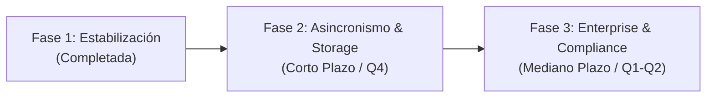

# 🗺️ Roadmap de Evolución Empresarial — LicitaGestión

Este documento define la trayectoria técnica y funcional del proyecto **LicitaGestión**, marcando la transición desde el prototipo funcional verificado (versión 2.0.0) hacia una plataforma empresarial de alta disponibilidad, rendimiento y cumplimiento normativo.

---

## 📌 Estado Actual (Versión 2.0.0 — Octubre 2026)

| Dimensión | Estado | Observación |
|---|---|---|
| **Seguridad Base** | ✅ Base implementada | CSRF activo, CSP, BCrypt 12, cookies `HttpOnly`/`SameSite` y limitador local de cinco fallos por IP/15 min. Para producción detrás de proxy configura `TRUSTED_PROXY_ADDRESSES`; varias réplicas requieren almacenamiento compartido del límite. |
| **Control de Sesiones** | ✅ Implementado | El cambio de contraseña invalida sesiones anteriores en su siguiente solicitud API (`password_updated_at`); la desactivación bloquea el acceso en la siguiente solicitud. |
| **Optimización de Consultas** | ✅ Mejorada | `/api/tasks` evita N+1; el dashboard carga requisitos, tareas e hitos con tres consultas agrupadas en vez de tres por proceso. Sigue leyendo todo el alcance visible y requiere paginación/medición al crecer mucho. |
| **Persistencia & Transacciones** | ✅ Completada | Caché de `SimpleJdbcInsert`, desacoplamiento de llamadas IA fuera de transacciones JDBC. |
| **Paginación** | ✅ Implementada | Pantallas de procesos y actividad recorren páginas de 25; API limita el tamaño a 100. Procesos permiten búsqueda y estado desde el servidor. Sin parámetros se conserva el formato legado; auditoría sin paginar muestra los últimos 200. |
| **Automatización CI/CD** | ✅ Completada | Pipeline GitHub Actions con compilación, análisis y ejecución de pruebas en JDK 25. |

---

## 🚀 Fases de Evolución

---

### Fase 2: Escalabilidad, Almacenamiento en Nube y Asincronismo (Q4 2026)

#### 1. Arquitectura de Trabajos Asíncronos para Documentos Pesados
* **Problema:** Documentos de licitación extensos (50 a 100 páginas) analizados mediante LLM pueden requerir 30-45 segundos de cómputo, amenazando con saturar hilos de Tomcat y provocar timeouts HTTP (Cloudflare / Nginx 504).
* **Solución:**
  * Implementar procesamiento en segundo plano con Spring `@Async` o colas livianas (Redis / RabbitMQ).
  * La subida (`POST /api/tenders/{tid}/documents`) devuelve HTTP 202 Accepted con `status: PENDING`.
  * La interfaz realiza polling pasivo o escucha Server-Sent Events (SSE) para reflejar el análisis completado.

#### 2. Pipeline OCR para PDFs Escaneados
* **Problema:** En el mercado público, muchas bases y anexos son documentos escaneados sin capa de texto (`SIN_TEXTO_OCR_PENDIENTE`).
* **Solución:**
  * Integrar motor de extracción OCR (Tesseract / AWS Textract / Google Cloud Document AI).
  * Pre-procesamiento de imagen (deskewing, binarización) previo al envío a extracción extractiva o LLM.

#### 3. Abstracción de Almacenamiento de Archivos (Cloud Object Storage)
* **Problema:** El almacenamiento actual depende del sistema de archivos local (`./data/private-documents`), lo que impide el escalado horizontal de contenedores en Kubernetes o ECS.
* **Solución:**
  * Crear interfaz `StorageProvider` con implementaciones:
    * `LocalStorageProvider` (entornos locales / desarrollo).
    * `S3CompatibleStorageProvider` (AWS S3, MinIO, Cloudflare R2, Google Cloud Storage).
  * Descargas directas mediante presigned URLs para liberar ancho de banda del backend.

---

### Fase 3: Gobernanza Corporativa, SSO y Webhooks (Q1-Q2 2027)

#### 1. Autenticación Multifactor (MFA/2FA) y Federación SSO
* Soporte para TOTP (Google Authenticator / Microsoft Authenticator) obligatorio para administradores y gestores.
* Integración OIDC / SAML 2.0 para autenticación corporativa unificada con Microsoft Entra ID (Azure AD) y Google Workspace.

#### 2. Webhooks de WhatsApp Cloud API
* Configuración de endpoint receptor (`POST /api/webhooks/whatsapp`) para recibir confirmaciones de entrega (`delivered`) y lectura (`read`) de avisos urgentes.
* Reintentos automáticos con backoff exponencial en caso de rechazo temporal por parte de Meta.

#### 3. Soporte Multi-Tenant
* Segmentación lógica de licitaciones por `organization_id` / `tenant_id` para permitir que una única instancia sirva a múltiples unidades de negocio o subsidiarias de forma aislada.

#### 4. Observabilidad de Nivel Bancario
* Exposición de métricas Prometheus (`micrometer-registry-prometheus`).
* Rastreo distribuido con OpenTelemetry para trazar la latencia de llamadas a proveedores de IA y base de datos.

